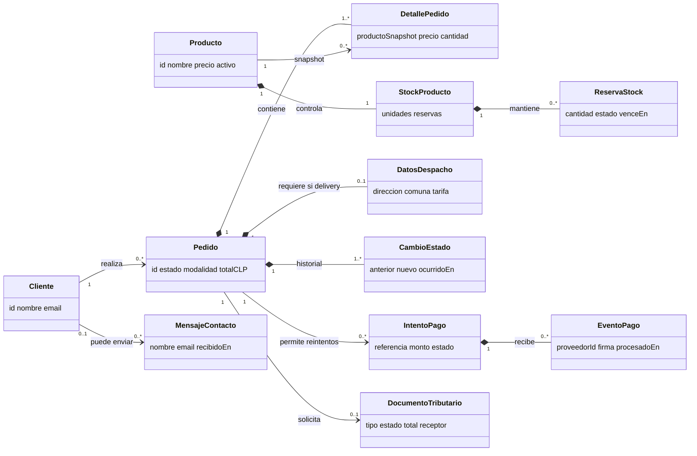

# Informe técnico: diseño e implementación de backend seguro

## Tokyo Noodles

**Integrante:** Vicente Hormazábal  
**Caso:** Tokyo Noodles, restaurante de ramen y gyozas. El número oficial de caso no fue informado.  
**Versión entregada:** paquete actualizado a Módulo 10; frontend responsivo HTML/CSS/Bootstrap 5.3.8/JavaScript. El repositorio no asigna una versión semántica anterior.  
**Fecha:** 9 de noviembre de 2026  
**Producto evaluado:** frontend conectado a backend local, arquitectura, contratos, persistencia, controles y pruebas reproducibles.

---

## Resumen ejecutivo

Tokyo Noodles integra las pantallas responsivas del restaurante con un API Gateway, Auth/Clients, Inventory, Orders, Payments y un GraphQL Gateway privado. El flujo principal permite cargar el menú, registrarse o iniciar sesión, crear un pedido con precios calculados por el servidor, reservar stock, iniciar un pago de prueba, confirmar el resultado mediante un evento HMAC y consultar el seguimiento del pedido propio. Personal autorizado consulta inventario, registra ajustes y avanza pedidos por transiciones permitidas.

Los cuatro dominios transaccionales conservan sus datos en archivos JSON separados y versionados. Las escrituras se serializan dentro del proceso propietario y se guardan mediante archivo temporal y renombrado. Las contraseñas de cuentas registradas se almacenan con scrypt y salt; las sesiones usan cookie HttpOnly con expiración de una hora. Los servicios internos exigen tokens técnicos de alcance específico y enlazan a loopback. El Gateway descarta identidad aportada por el navegador y deriva titular/rol desde la sesión verificada.

Las pruebas locales registradas pasaron: M7, 7 controles; M8, 10 comprobaciones; M10, 10 pruebas. La carga GraphQL ejecutó 20/20 solicitudes con cuatro trabajadores concurrentes, cero errores y p95 de 82,16 ms. La medición es pequeña y local; no representa capacidad de producción.

Se documentan brechas que no deben confundirse con servicios reales: el pago usa un adaptador de prueba sin movimiento de dinero; no hay emisor DTE/SII ni PDF tributario; el contacto se persiste localmente pero no envía correo; no hay courier externo. La persistencia JSON, el proveedor local de secretos y el enlace loopback son adecuados para una demostración académica reproducible, no para operar con clientes reales.

## 1. Alcance, requisitos y decisiones

### 1.1 Requisitos funcionales derivados de las pantallas

| Requisito | Resultado esperado | Estado en esta entrega |
|---|---|---|
| Catálogo y detalle | Mostrar productos públicos, precio, categoría y disponibilidad de venta. | Integrado con Inventory a través del Gateway. |
| Registro y autenticación | Crear cuenta de cliente, iniciar/cerrar sesión y proteger recursos propios. | Registro persistente, hash scrypt; cookie HttpOnly. Las cuentas de personal son ficticias y se configuran localmente. |
| Pedido | Crear pedido de retiro o despacho y solicitar boleta/factura. | Integrado; el servidor valida productos, reserva stock y calcula total. |
| Pago | Iniciar intento, recibir resultado verificado y actualizar pedido. | Integrado con adaptador de prueba HMAC; no procesa dinero. |
| Seguimiento | Consultar hitos y líneas del pedido propio. | Integrado a través del GraphQL Gateway. |
| Inventario | Consultar saldos y registrar ajustes auditables. | Integrado con autorización por rol. |
| Operación/despacho | Revisar pedidos recientes y avanzar estados permitidos. | Vista de operaciones integrada; los estados son internos, sin courier externo. |
| Documentos | Consultar documentos asociados a compras propias. | Se listan registros internos de pedidos pagados; no son documentos fiscales ni incluyen PDF tributario. |
| Contacto | Recibir consulta y confirmar recepción. | Mensaje validado y persistido por 90 días; no se integra correo externo. |

### 1.2 Reglas de negocio aplicadas

- El cliente no fija `clientId`, precio, subtotal, total, saldo de stock ni resultado de pago.
- El pedido se crea con `Idempotency-Key`. Misma clave y misma carga devuelve el pedido anterior; misma clave con datos distintos responde conflicto.
- Inventory reserva cantidades por un plazo. Un pago aprobado consume la reserva; un pago fallido libera stock.
- Payments verifica firma HMAC, antigüedad del evento e idempotencia antes de pedir a Orders que aplique el resultado.
- Orders mantiene la autoridad del estado del pedido y valida transiciones. Un pedido ajeno responde 404 igual que uno inexistente.
- Roles operativos se comprueban en Gateway y servicio dueño. Ocultar controles visuales no concede permiso.
- Las líneas del pedido conservan nombre y precio aplicados para no depender del catálogo vigente al consultar historial.

### 1.3 Brechas, supuestos y límites comerciales

No se informó número oficial del caso. El precio de despacho está configurado como cero; zonas, cobertura y tarifas deben ser confirmadas por el negocio. El estado temporal de pedidos puede liberar una reserva al fallar el pago o expirar la operación, pero no existe un trabajo programado de expiración. La transición manual de cancelación no está cubierta por las pruebas de restitución de stock. La emisión fiscal, folios, formato legal, descarga PDF y plazos contables requieren definición con el responsable tributario y un proveedor autorizado. No hay proveedor de pago, correo o despacho real configurado.

## 2. Módulo 1 — Servicios y contratos

### 2.1 Catálogo de operaciones

Los cuerpos son JSON y los errores usan `{ "error": { "code", "message" } }`. El contrato detallado, los campos, validaciones y ejemplos ficticios S01–S13 están en `MODULO 1/Modulo-1-Tokyo-Noodles.md`; S14 se incorpora en esta tabla. La API externa publica rutas fijas; los puertos de servicios no forman parte de los DTO del navegador.

| ID | Pantalla/acción | Contrato externo | Entrada principal | Salida/regla clave | Acceso |
|---|---|---|---|---|---|
| S01 | Inicio / Menú: catálogo | `GET /api/v1/products?available=&category=&q=` | Filtros opcionales; búsqueda ≤80 caracteres. | Productos publicables; no incluye stock exacto. | Anónimo. |
| S02 | Detalle de producto | `GET /api/v1/products/{id}` | ID de producto. | Ficha pública o 404. | Anónimo. |
| S03 | Registro y sesión | `POST /api/v1/auth/registrations`, `POST /api/v1/auth/sessions`; `DELETE /api/v1/auth/sessions/current` | Registro: nombre, email y contraseña de 12–128 caracteres. Login: email y contraseña. | Perfil mínimo; cookie HttpOnly de una hora. Contraseña registrada en scrypt+salt. | Anónimo al registrar/ingresar; sesión para logout. |
| S04 | Contacto | `POST /api/v1/contact-messages` | Nombre, email y mensaje (5–2.000 caracteres). | ID y estado `received`; límite de 4/min; retención local de 90 días. | Anónimo. |
| S05 | Facturas/documentos propios | `GET /api/v1/me/invoices` | Cookie de sesión; no acepta titular del cliente en query. | Lista documentos internos de pedidos pagados del titular. Sin cursor en la implementación. | Cliente autenticado. |
| S06 | Descargar PDF de factura | `GET /api/v1/me/invoices/{id}/document` | ID del documento y sesión. | **Brecha:** no hay endpoint PDF ni emisor fiscal. | No implementado. |
| S07 | Crear pedido | `POST /api/v1/orders` | Líneas, modalidad, documento y, según corresponda, dirección/datos de facturación; `Idempotency-Key`. | `201` con ID, estado `pending_payment` y total calculado por el servidor; reserva stock. | Cliente autenticado. |
| S08 | Iniciar pago | `POST /api/v1/orders/{id}/payments` | Pedido propio pendiente; el navegador no decide monto ni estado. | Intento `pending` y URL de checkout demo. | Titular autenticado. |
| S09 | Webhook de pago | `POST /api/v1/integrations/payments/demo/events` | Evento firmado: `eventId`, `paymentId`, `status`, `occurredAt`. | HMAC, ventana de cinco minutos y deduplicación; Orders aplica transición. | Proveedor/adaptador autenticado por firma. |
| S10 | Pedido propio | `GET /api/v1/me/orders/{id}` | ID en ruta; titular desde cookie. | Resumen e hitos mínimos; recurso ajeno/inexistente 404. | Cliente titular. |
| G01 | Seguimiento agregado | `POST /api/v1/graphql` | Query `myOrderSummary(orderId, first, after)`. | Orders + descripciones públicas de Inventory; paginación y límites M8. | Cliente titular. |
| S11 | Inventario | `GET /api/v1/staff/inventory` | Cookie autenticada. | `onHand`, reservas y disponible para trabajo interno. | `inventory` u `operations`. |
| S12 | Ajuste de stock | `POST /api/v1/staff/inventory/{id}/adjustments` | `delta` no cero y motivo requerido. | Ajuste auditable; rechaza saldo bajo reservas. | Solo `inventory`. |
| S13 | Cambiar estado | `PUT /api/v1/staff/orders/{id}/status` | Estado destino permitido y nota opcional. | Nueva transición e historial. | Solo `operations`. |
| S14 | Cola operativa | `GET /api/v1/staff/orders` | Sin datos de identidad del cliente. | Hasta 100 pedidos recientes con ID, estado, modalidad, total y fecha. | Solo `operations`. |

### 2.2 Ejemplos JSON compactos

Valores enteramente ficticios. Los ejemplos muestran la forma de los DTO; no son credenciales ni datos reales.

```json
[
 {"S01":{"items":[{"id":1,"nombre":"Tokyo Shoyu","precio":8990,"disponible":true}]}},
 {"S03":{"request":{"name":"Cliente Demo","email":"cliente@example.test","password":"ejemplo-no-reutilizable"},"response":{"cliente":{"id":"cli_demo_1","nombre":"Cliente Demo"}}}},
 {"S04":{"request":{"name":"Persona Demo","email":"persona@example.test","message":"Consulta ficticia."},"response":{"id":"msg_demo_1","status":"received"}}},
 {"S07":{"request":{"items":[{"productId":1,"quantity":1}],"fulfillment":"pickup","documentType":"boleta"},"response":{"id":"ord_demo_1","status":"pending_payment","total":8990}}},
 {"S08":{"paymentId":"pay_demo_1","status":"pending"}},
 {"S09":{"eventId":"evt_demo_1","paymentId":"pay_demo_1","status":"succeeded","occurredAt":"2026-11-09T12:00:00Z"}},
 {"S14":{"items":[{"id":"ord_demo_1","status":"confirmed","fulfillment":"pickup","total":8990,"currency":"CLP"}]}}
]
```

S02, S05, S06, S10, S11–S13 y los errores/códigos se detallan en la matriz M1 del proyecto. El contrato S06 se conserva como necesidad, pero la implementación y la brecha están identificadas explícitamente.

## 3. Módulo 2 — Modelo de dominio y UML

Los diagramas editables están en `UML MODULO 2/UML-Dominio-Tokyo-Noodles.mmd` y `UML MODULO 2/UML-Servicios-Tokyo-Noodles.mmd`. Las entidades modelan titularidad, snapshots históricos, reservas, pagos y transiciones; los DTO no exponen la entidad completa.

### Diagrama visual de clases del dominio

El esquema siguiente muestra las entidades centrales, sus atributos representativos y las multiplicidades de las relaciones. Se incluye el detalle ampliado en los archivos UML editables del proyecto.

<!-- UML-DOMINIO-VISUAL -->



| Relación UML | Cardinalidad | Regla que la sustenta |
|---|---|---|
| Cliente — Pedido | Cliente `1` a Pedido `0..*`; cada Pedido tiene un Cliente | Un cliente puede no comprar o realizar muchos pedidos; cada pedido tiene un único titular. |
| Pedido *— DetallePedido | Pedido `1` a Detalle `1..*` | Pedido confirmado se compone de al menos una línea; la línea no tiene sentido sin pedido. |
| Producto — DetallePedido | Producto `1` a Detalle histórico `0..*` | Un producto aparece en múltiples líneas o ninguna; cada línea conserva referencia y snapshot. |
| Producto *— StockProducto | Producto `1` a Stock `1` | En el modelo de una sucursal hay un saldo por producto. |
| StockProducto *— ReservaStock | Stock `1` a Reserva `0..*` | Hay cero o varias reservas activas/históricas por producto. |
| Pedido *— DatosDespacho | Pedido `1` a dirección `0..1` | Retiro no requiere dirección; despacho usa una dirección para esa orden. |
| Pedido *— CambioEstado | Pedido `1` a cambios `1..*` | Se registra la creación y se conserva el historial de estados. |
| Pedido — IntentoPago | Pedido `1` a intentos `0..*` | Un pedido puede no pagarse o tener reintentos. |
| IntentoPago *— EventoPago | Intento `1` a eventos `0..*` | Cada intento puede recibir notificaciones/duplicados que quedan deduplicados por ID. |
| Pedido — DocumentoTributario | Pedido `1` a documento `0..1` | En la propuesta hay como máximo un documento principal; la emisión real no está conectada. |
| Documento — LíneaDocumento | Documento `1` a líneas `1..*` | El documento conserva snapshot de venta y desglose. |
| StockProducto *— AjusteInventario | Stock `1` a ajustes `0..*` | El saldo tiene historial de cambios; los ajustes no se borran. |
| Personal — AjusteInventario | Personal `1` a ajustes `0..*` | Cada ajuste operativo tiene actor autenticado. |
| Cliente — MensajeContacto | Cliente `0..1` a mensajes `0..*` | El contacto puede ser anónimo o asociarse en una versión futura. |

Las clases de servicio del UML corresponden a Catalog, ClientAuth, Contact, Invoice, Order, Payment, Inventory y OrderOperations. Las operaciones S01–S14 se vinculan en la matriz M1. El modelo de carrito es conceptual y vive temporalmente en frontend; no se persiste como Pedido hasta confirmación.

## 4. Módulo 3 — Sistemas y colaboraciones

| Sistema | Autoridad y datos | Servicios | Dependencias / fallo |
|---|---|---|---|
| Inventory | Catálogo publicable, precio, saldo, reservas y ajustes. Decide disponibilidad. | S01, S02, S11, S12; participa en S07/S10 GraphQL. | Orders reserva/libera/consume. Caída o stock insuficiente: el pedido no queda confirmado. |
| Orders | Pedido, titular, snapshots de línea/precio, total, modalidad, documento solicitado, hitos/estado. | S07, S10, S13, S14, S05 interno. | Inventory para reservas; Payments informa resultado autenticado. Guarda un snapshot para que el historial no dependa del catálogo actual. |
| Clients/Auth | Cuentas, roles, hash de contraseña, identidad verificada y sesiones. | S03, identidad para rutas privadas y contacto. | Gateway consulta/valida sesión. Fallo de Auth impide operaciones protegidas. |
| Payments | Intentos, referencias, eventos y estado del intento. | S08, S09. | Consulta total/propiedad y solicita a Orders transición. Si Orders no responde, no acepta el webhook para permitir reintento. |

### Mapa de componentes

```text
┌───────────────────── Zona del cliente ─────────────────────┐
│ Frontend responsivo (docs/) ── cookie HttpOnly ──► Gateway │
└─────────────────────────────────────────────────────────────┘
                                                │ allowlist/rol/rate limit
       ┌────────────────────────────────────────┼───────────────────────┐
       ▼                    ▼                   ▼                       ▼
  Clients/Auth          Inventory             Orders                Payments
  :4103                  :4101                :4102                   :4104
       ▲                    ▲                   │  ▲                    │
       │                    └──── reservas ─────┘  └──── evento ───────┘
       └─────────────────────────────────────────┐
                                                  ▼
                                         GraphQL Gateway :4200
                                        (privado: Orders + Inventory)
```

Los componentes externos Pago/DTE/Mensajería se modelan como fronteras de proveedor. En el prototipo solo el adaptador de pago simula de forma controlada el contrato de webhook; no se declara conexión a esos proveedores.

### Secuencia de compra y pago

1. El cliente inicia sesión; Gateway consulta Clients y establece cookie HttpOnly.
2. Cliente crea pedido con líneas/modo/documento y `Idempotency-Key`.
3. Gateway deriva identidad; Orders valida DTO, lee precio/catálogo y solicita reserva a Inventory.
4. Orders guarda estado `pending_payment`, snapshots y total calculado; devuelve resumen.
5. Cliente inicia pago para su pedido; Payments vuelve a verificar titular, estado y monto oficial con Orders.
6. En la demostración, checkout de prueba genera un evento firmado desde el Gateway. Payments verifica HMAC, frescura y duplicados.
7. Payments manda evento autenticado a Orders; Orders acepta transición y consume reserva si fue aprobado o libera si falló.
8. Seguimiento GraphQL lee Orders y agrega nombres públicos de Inventory mediante un batch. La consulta no modifica datos.

## 5. Módulo 4 — Stakeholders y permisos

| Stakeholder | Rol/identidad | Necesidad | Permiso operativo |
|---|---|---|---|
| Visitante/comensal potencial | Anónimo | Menú, detalle y contacto. | GET S01/S02; POST S04 sujeto a validación y cuota. |
| Cliente | `customer` | Comprar, seguir pedido y consultar documentos propios. | S03/S07/S08/S10/S05/G01; titularidad verificada en Orders. |
| Personal inventario | `inventory` | Consultar saldo y registrar ajuste. | GET S11, POST S12; ajuste no puede dejar disponible bajo cero. |
| Operaciones/cocina/despacho | `operations` | Cola y transiciones de pedidos. | GET S14, GET S11, PUT S13; transición válida para estado vigente. |
| Administración/dueño | Stakeholder sin rol automático | Supervisión/indicadores. | Sin permisos por cargo; acceso operativo requiere asignación explícita. |
| Proveedor de pago | Identidad técnica por HMAC | Notificar resultado de un intento. | POST S09 firmado, con fecha y evento únicos. |
| DTE, email, courier, docente | Proveedor futuro / receptor académico | Emisión, entrega, revisión. | Sin permisos operativos directos implementados. |

| Ruta | Anónimo | Customer | Inventory | Operations | Regla principal |
|---|---|---|---|---|---|
| GET `/api/v1/products*` | Permitido | Permitido | Permitido | Permitido | DTO público; nunca stock físico. |
| POST `/api/v1/auth/registrations`, `/sessions` | Permitido | N/A | N/A | N/A | Validación de correo/clave; rate limit; error genérico de login. |
| POST `/api/v1/contact-messages` | Permitido | Permitido | Permitido | Permitido | Campos acotados, máximo de cuerpo y 4/min por IP. |
| POST `/api/v1/orders`, POST `.../{id}/payments` | Denegado | Permitido | Denegado | Denegado | Cliente autenticado; propiedad y estado verificadas. |
| GET `/api/v1/me/orders/{id}`, `/me/invoices`, POST `/graphql` | Denegado | Permitido | Denegado | Denegado | Solo datos propios; recurso ajeno e inexistente no se distinguen. |
| GET `/api/v1/staff/inventory` | Denegado | Denegado | Permitido | Permitido | Datos internos, solo lectura por rol de personal. |
| POST `/api/v1/staff/inventory/{id}/adjustments` | Denegado | Denegado | Permitido | Denegado | Motivo requerido, delta válido, saldo reservado protegido. |
| GET `/api/v1/staff/orders`, PUT `.../{id}/status` | Denegado | Denegado | Denegado | Permitido | DTO mínimo de cola y transición de estado autorizada. |
| POST `/api/v1/integrations/payments/demo/events` | Denegado sin firma | Denegado | N/A | N/A | HMAC, frescura, idempotencia; nunca se confía en retorno de browser. |

Los verbos no listados se rechazan; no hay DELETE de pedidos/documentos para “completar CRUD”. Cancelar es transición de estado y mantiene historial.

## 6. Módulos 5 y 6 — Gateways, rutas e identidades técnicas

### Fronteras de confianza y UML de Gateway

Hay un API Gateway REST externo para autenticación de sesión, autorización por ruta/rol, límites, CORS, destinos fijos, normalización de errores y logging con correlación. Se evita un segundo gateway administrativo porque las políticas por ruta bastan para el caso. GraphQL corre como proceso privado.

El UML editable está en `M5/UML-Gateway-y-Politicas.mmd`; sus relaciones estructurales principales son:

| Relación | Multiplicidad | Interpretación |
|---|---|---|
| ApiGateway *— RouteDefinition | Gateway `1` a rutas `1..*` | Cada ruta pertenece a una definición allowlist. |
| RouteDefinition — AuthenticationPolicy | Muchas rutas a política `1` | Política aplicable: anónima, sesión, rol o firma de proveedor. |
| RouteDefinition — AuthorizationPolicy | Muchas rutas a política `1` | Define rol, ámbito y condición de recurso. |
| RouteDefinition — RateLimitPolicy | Muchas rutas a política `1` | Cuota por ruta y clave de cliente/IP en prototipo. |
| RouteDefinition — ServiceTarget | Muchas rutas a destino `1` | Las rutas apuntan a un destino interno predefinido; el cliente no elige URL. |
| ApiGateway ..> AuthService / SecretProvider | Dependencias | Verifica sesión y obtiene credenciales técnicas. |
| GraphQLGateway *— Schema *— Resolver | Gateway `1` a Schema `1`; Schema a resolver(es) | Schema define queries/campos; resolver aplica autorización y llamada batch a adaptadores. |
| GraphQLGateway ..> OrdersAdapter / InventoryAdapter | Dependencias | Composición por API privada, sin acceso directo a archivos de otros servicios. |

En desarrollo, `SecretProvider` resuelve referencias desde el entorno del proceso consumidor. Vault/Secret Manager es una opción productiva documentada, no una integración desplegada en este prototipo.

### Rutas públicas y privadas

| Servicio | Puerto local | Rutas/acción representativa | Identidad técnica |
|---|---:|---|---|
| API Gateway | 4000 | `/api/v1/products`, auth, pedido, pago, personal, contacto, GraphQL | Secretos técnicos mínimos por destino. |
| Inventory | 4101 | catálogo, batch GraphQL, existencias, reservas, ajustes | `GATEWAY_INVENTORY_READ_TOKEN`, `GATEWAY_INVENTORY_WRITE_TOKEN`, `ORDERS_INVENTORY_READ_TOKEN`, `ORDERS_INVENTORY_TOKEN`, `GRAPHQL_INVENTORY_READ_TOKEN`. |
| Orders | 4102 | crear/leer pedido, pagos, inventario interno, cola/transición, facturas internas | `GATEWAY_ORDERS_CREATE_TOKEN`, `GATEWAY_ORDERS_READ_TOKEN`, `GATEWAY_ORDERS_OPERATIONS_TOKEN`, `PAYMENTS_ORDERS_TOKEN`, `GRAPHQL_ORDERS_READ_TOKEN`. |
| Clients/Auth | 4103 | registro, crear/verificar sesión, mensajes | `GATEWAY_CLIENTS_TOKEN`; `SESSION_SECRET` solo en Clients. |
| Payments | 4104 | iniciar checkout y procesar evento | `GATEWAY_PAYMENTS_API_TOKEN`, `GATEWAY_PAYMENTS_EVENT_TOKEN`, `PAYMENTS_ORDERS_TOKEN`; `PAYMENT_WEBHOOK_SECRET`. |
| GraphQL Gateway | 4200 | `POST /graphql` interno | `GATEWAY_GRAPHQL_TOKEN`; llama Orders e Inventory con credenciales de lectura separadas. |

Todos los procesos escuchan en `127.0.0.1`. El navegador no conoce tokens ni puertos internos. Un llamado directo a Inventory/Orders/GraphQL sin token recibe 401. Se propaga `X-Verified-*` desde Gateway solo después de verificar cookie; cabeceras homónimas del navegador no establecen identidad. En producción se debe sustituir loopback por subred privada, TLS/mTLS y gestor de secretos real.

### Referencias simbólicas de secretos

El paquete académico incluye `MODULO 3/backend/.env` con valores aleatorios de demostración y cuentas ficticias, a petición del equipo. No contiene credenciales de proveedores reales. `.env.example` conserva nombres y placeholders; `prepare-local.mjs` genera una configuración nueva si no existe. El archivo está ignorado por Git de manera predeterminada, por lo que su inclusión intencional requiere `git add -f`. No se debe reutilizar ni publicar con acceso a sistemas reales; rótalo si se cambia a un repositorio público. El supervisor entrega a cada proceso solo las variables que consume.

| Referencia | Consumidor/finalidad | Protección y ciclo |
|---|---|---|
| `GATEWAY_*_TOKEN` | Gateway a cada servicio/destino, limitado por ruta y propósito. | Distinto por integración; solo proceso consumidor. Rotar/revocar en entorno productivo. |
| `ORDERS_INVENTORY_*`, `PAYMENTS_ORDERS_TOKEN` | Orders/Payments a Inventory/Orders. | Mínimo privilegio de reserva, lectura o resultado. No exponer al navegador. |
| `GRAPHQL_*_READ_TOKEN`, `GATEWAY_GRAPHQL_TOKEN` | Gateway ↔ GraphQL y GraphQL ↔ sistemas de lectura. | Solo lectura para integridad agregada; un token por servicio. |
| `SESSION_SECRET` | Clients firma/verifica cookie de sesión. | No es contraseña del usuario; rotación invalida sesiones firmadas anteriores. |
| `PAYMENT_WEBHOOK_SECRET` | Payments valida HMAC del proveedor/adaptador. | No va en frontend ni logs; rotar ante filtración. |
| `DEMO_*_EMAIL/PASSWORD` | Cuentas académicas ficticias configurables. | No reutilizar en producción; empleados reales deben usar identidad gestionada. |

Health: `GET /health` en Gateway consulta dependencias, con timeout por dependencia. Logs JSON del Gateway incluyen `requestId`, `routeId`, método, estado y duración; excluyen cuerpos, cookies, cabeceras de autorización, emails y secretos.

## 7. Módulo 7 — Datos, credenciales y privacidad

| Dato | Clase | Custodio/uso | Protección y retención |
|---|---|---|---|
| Nombre/email del cliente | Personal restringido | Clients para cuenta, Clients para contacto. | Sesión y DTO mínimos; mensajes locales se purgan al escribir si superan 90 días. |
| Contraseña | Credencial de usuario | Auth/Clients. | Se procesa en login; cuentas registradas guardan verificador scrypt con salt, nunca texto plano. Las claves demo se configuran localmente en `.env`; no usarlas con datos reales. |
| Cookie/tokens de sesión | Credencial de sesión | Browser porta cookie; Clients verifica. | HttpOnly, SameSite=Lax, una hora; no revocación persistente más allá de borrar cookie/logout. |
| Dirección de despacho y datos de factura | Dato personal/tributario restringido | Orders, porque entrega/documento solicitado. | Solo operación del pedido; no catalogar ni usar en respuesta de seguimiento agregada. JSON local no está cifrado ni tiene purga productiva. |
| Líneas, total, estado e historial | Transaccional restringido | Orders/Payments. | Propiedad en servicio dueño; snapshot; no se expone recurso ajeno. |
| Saldo/reservas/ajustes | Interno de operación | Inventory. | Solo roles operativos; catálogo público muestra booleano de disponibilidad. |
| HMAC y `*_TOKEN` | Secreto de integración | Proceso específico vía SecretProvider. | En este paquete son valores aleatorios de demostración; en producción: gestor de secretos, mínimo privilegio, TLS/mTLS y rotación. |
| Número de tarjeta/CVV | Financiero altamente sensible | No lo custodia la aplicación. | No se recopila; checkout del adaptador demo no cobra. |
| Logs técnicos | Operacional | Gateway. | Solo correlación/ruta/estado/duración; no payload ni PII innecesaria. |

**Decisión sobre secretos del cliente:** sí se maneja una credencial de cuenta (contraseña y sesión), no un secreto de tarjeta. El adaptador evita recibir tarjeta. La sesión expira, pero la revocación individual persistente, recuperación de cuenta, MFA y endurecimiento de login no se implementan.

**Recorrido de dirección:** el formulario la captura solo al elegir despacho; viaja en cuerpo, no URL; Gateway verifica cliente e inserta identidad; Orders guarda dirección asociada al pedido; el resumen GraphQL no devuelve calle/dirección; personal autorizado requiere dirección para entregar. Política final de conservación/eliminación debe ser aprobada por negocio y normativa; la demostración local no implementa cifrado ni retención de pedidos.

## 8. Módulo 8 — GraphQL privado y agregación

La pantalla `seguimiento.html` consulta `POST /api/v1/graphql` en el Gateway. Este verifica cookie/rol, descarta headers de identidad aportados por el navegador y llama a GraphQL privado `POST /graphql` con su propio token y contexto verificado. Solo existe la query `myOrderSummary`; no hay mutations.

```graphql
query M8Summary($orderId: ID!, $first: Int!, $after: String) {
  myOrderSummary(orderId: $orderId) {
    id status fulfillment total currency catalogStatus
    timeline { status at }
    items(first: $first, after: $after) {
      nodes { productId quantity unitPrice lineTotal
        product { name category description }
      }
      totalCount pageInfo { endCursor hasNextPage }
    }
  }
}
```

Orders confirma la propiedad y devuelve estado, hitos y líneas snapshot. GraphQL recoge IDs únicos y hace una llamada batch a Inventory para atributos públicos actuales; evita N+1 y no lee archivos ajenos. Si Inventory no responde, conserva el resumen de Orders y retorna error parcial `CATALOG_PARTIAL`. Un pedido ajeno se representa como inexistente.

Controles ejecutados: body ≤16 KiB; texto GraphQL ≤8 KiB; introspección denegada; una query raíz permitida; profundidad máxima 6; costo máximo 250; página 1–20 (frontend 5); pedido hasta 30 líneas; timeout de servicio 1,5 s y agregado 3,5 s; rate limit 30/min/IP; batching; CORS allowlist. La suite M8 verificó fields inválidos, introspección, página 21, costo excesivo, acceso sin sesión, personal, propiedad, llamada directa sin token y falla de Inventory.

Archivos fuente: `MODULO 3/backend/graphql-gateway/schema.graphql`, `schema.js`, `server.js`; query: `M8/consulta-prueba.graphql`; respuesta de referencia: `M8/respuesta-ficticia.json`.

## 9. Módulo 9 — ADR de analítica y gRPC

**Decisión:** no implementar un servicio analítico ni gRPC para los requisitos actuales. El caso es un local con seis productos ficticios, pedidos de hasta 30 líneas y lectura de seguimiento bajo demanda. No hay dashboard histórico, alta frecuencia, streaming, GPS, procesamiento masivo ni integración que necesite mensajes tipados/stream. GraphQL ya agrega una lectura pequeña Orders+Inventory. Añadir Analytics duplicaría datos personales sin una pregunta de negocio; gRPC añadiría operación sin carga medida que lo justifique.

| Carga observada | Valor |
|---|---:|
| Método | `POST /api/v1/graphql`, seguimiento de pedido propio |
| Solicitudes/concurrencia | 20 / 4 |
| Solicitud promedio/máxima | 325 B / 325 B |
| Respuesta promedio | 209 B |
| HTTP/errores | 20 × 200; 0 error GraphQL/HTTP |
| Latencia | p50 18,07 ms; p95 82,16 ms; p99/máx. 83,41 ms |
| Throughput | 124,11 solicitudes/s en una ráfaga de 0,1611 s |
| Recursos medidos | 7 procesos; CPU 0,6406 s; 11,31% relativo a 12 CPU lógicas; working set máximo observado 348,48 MB |
| Ventana recursos | 0,4721 s; tres muestras de memoria a ~10 ms |

Resultado: bajo la meta local de p95 500 ms y 0% error en esta muestra. La ventana y tamaño de muestra son pequeños, loopback y storage JSON; no se extrapola a producción. No se declara ventaja de gRPC ni se emite contrato `.proto` porque no aplica. Evidencia: `M9/evidencia-carga.json`, `M9/Resultados-carga.md`, ejecutor `M9/medir-carga.ps1` y prueba `M9/prueba-carga.mjs`.

## 10. Módulo 10 — Persistencia, despliegue y pruebas

### 10.1 Persistencia y migraciones

`MODULO 3/backend/lib/store.js` define store schemas v1 para Inventory (`products`, `reservations`, `adjustments`), Orders (`orders`), Payments (`payments`, `events`) y Clients (`users`, `messages`). El primer acceso crea datos ficticios/esquema; al leer un store antiguo, la migración v1 agrega arreglos faltantes; las escrituras usan cola por nombre y reemplazo temporal. Cada servicio solo modifica su archivo. El mecanismo es persistencia real en disco, no memoria, aunque no es una base relacional: no aporta transacciones entre servicios, bloqueo multiinstancia, cifrado en reposo, backup o recuperación automatizada.

### 10.2 Inicio y detención

1. Node.js 20+ y PowerShell.
2. En `MODULO 3/backend`: `npm ci`, `npm run prepare:local`, `node dev.js`.
3. En otra terminal, raíz del proyecto: `node M8/servidor-estatico-seguro.mjs`; abrir `http://localhost:5500/`.
4. `npm run seed` inicializa/verifica catálogo; las operaciones posteriores crean pedidos, pagos, registros, mensajes y ajustes ficticios.
5. Ejecutar `npm run test:m7`, `npm run test:m8`, `npm run test:m10` y `powershell -ExecutionPolicy Bypass -File .\M9\medir-carga.ps1` desde la raíz del proyecto (M9 inicia y detiene una instancia propia).
6. Cerrar `dev.js` con Ctrl+C. El paquete incluye `.env` solo para la demostración educativa; detener servicios antes de limpiar archivos de `backend/data/`.

La dependencia directa GraphQL.js está fijada en 16.14.2 y resuelta por `package-lock.json`; `.env.example` enumera referencias y no valores reales. `GET /health` del Gateway informa salud de dependencias. Los puertos 4000, 4101–4104 y 4200 escuchan loopback; las llamadas directas privadas sin token fallan.

### 10.3 Resultados de pruebas

| Suite | Comprobaciones | Resultado |
|---|---:|---|
| M7 seguridad | Catálogo anónimo; sesión ausente; rol cliente en ajuste; pedido ajeno; acceso directo a Inventory; pago alterado/firma falsa; DTO mínimos. | 7 PASS. |
| M8 integración GraphQL | Salud; identidad falsificada; tokens privados; agregación; paginación; propiedad; roles; introspección/costo/profundidad; CORS; fallo parcial de Inventory. | 10 PASS. |
| M10 negocio/seguridad | Catálogo; CORS/preflight; contacto; registro y scrypt; idempotencia pedido; ownership/acceso directo; rol y transición operations; recuperación stock; pago firmado/deduplicado; documentos propios. | 10 PASS. |
| M9 carga | 20 GraphQL de seguimiento, concurrencia 4. | 20/20 HTTP 200, 0 errores; p95 82,16 ms. |

Evidencia y comandos están en `M7/Validacion-backend.md`, `M8/Resultados-validacion.md`, `M10/Resultados-integracion.md` y `M9/Resultados-carga.md`. Son ejecuciones locales con datos ficticios, no pruebas de penetración ni certificación.

## 11. Mapa de trazabilidad de requisitos

| Requisito | Pantalla | Servicio | Prueba | Resultado | Evidencia |
|---|---|---|---|---|---|
| Catálogo público | Inicio, Menú, Detalle | S01/S02, Inventory | M7-1, M10-1 | PASS, seis productos sin stock exacto | Consola M7/M10 |
| Registro/autenticación | Pedido, Facturas, pantallas personal | S03, Clients | M7-2/3, M10-3/4 | PASS; hash scrypt y rol | `M10/Resultados-integracion.md` |
| Pedidos y totales | Pedido | S07, Orders+Inventory | M7-4/6, M10-5 | PASS; idempotencia, conflicto, total servidor | M10 test |
| Propiedad/seguimiento | Seguimiento | S10/G01, Orders+Inventory | M8-4/6, M10-6 | PASS; ajeno 404 | `M8/Resultados-validacion.md` |
| Pago y stock | Checkout demo | S08/S09, Payments+Orders+Inventory | M7-6, M10-8/9 | PASS; HMAC duplicado y restitución tras fallo | M10 test |
| Inventario | Admin/Inventario | S11/S12, Inventory | M7-3/7, M10-8 | PASS; roles y saldo protegido | M7/M10 test |
| Cola y estado | Admin/Pedidos | S13/S14, Orders | M10-7 | PASS; minimización y transición inválida rechazada | M10 test |
| Documentos propios | Facturas | S05, Orders | M10-10 | PASS; solo titular, documentos internos | M10 test |
| Contacto | Contacto | S04, Clients/messages | M10-2 | PASS; validación, persistencia, retención | M10 test |
| Límites GraphQL | Seguimiento | G01, GraphQL Gateway | M8-8/10 | PASS; abuso y caída de dependencia controlados | M8 test |
| Carga requerida/no analítica | Seguimiento | Gateway+GraphQL | M9 | PASS; 20/20, p95 82,16 ms | JSON y reporte M9 |

## 12. Autoevaluación frente a la rúbrica

La escala docente define logrado (100%), mayormente logrado (75%), parcial (50%), inicial (25%) y ausente (0%). La siguiente autoevaluación es orientativa y no pretende anticipar la nota.

| Criterio | Puntaje máx. | Nivel sustentado | Evidencia y límite principal |
|---|---:|---|---|
| Servicios y contratos | 10 | Mayormente logrado | S01–S14, ejemplos, rutas y validaciones; S06 PDF tributario no implementado y S05 no pagina. |
| UML y límites de microservicios | 10 | Mayormente logrado | UML editable de dominio, servicios y Gateway, multiplicidades justificadas; ajustar el UML si se agregan nuevas clases operativas/de integración. |
| Sistemas y persistencia | 10 | Mayormente logrado | Cuatro sistemas funcionales, JSON persistente/versionado; sin DB transaccional, multiinstancia ni backup. |
| Stakeholders y seguridad | 10 | Mayormente logrado | Roles, ownership, 401/403/404 y controles ejecutados; revocación persistente/MFA/hardening quedan pendientes. |
| API Gateway y secretos | 10 | Mayormente logrado | Gateway real, allowlist, CORS/rate limits, loopback y tokens por scope; SecretProvider en desarrollo usa `.env`, no gestor externo ni TLS/mTLS local. |
| Agregaciones GraphQL | 15 | Logrado en el alcance local | Agrega Orders+Inventory por HTTP privado, batching, límites, propiedad, fallo parcial y 10 comprobaciones. |
| Analítica y gRPC según aplicabilidad | 10 | Logrado según no aplicabilidad fundamentada | ADR y carga reproducible; no `.proto`/Analytics al no existir necesidad actual. |
| Backend completo e integración | 15 | Mayormente logrado | Pantallas y rutas principales integradas; pago, correo y DTE usan límites/adaptadores documentados; datos fiscales y PDF sin proveedor. |
| Pruebas y reproducibilidad | 10 | Logrado en local | 7+10+10 verificaciones, carga, guía, health y variables simbólicas; falta pipeline CI y despliegue replicado en contenedores. |

## 13. Brechas y siguiente etapa

1. Sustituir JSON por PostgreSQL u otro almacén transaccional y separar credenciales por base; añadir migraciones versionadas, constraints, rollback/saga y pruebas multiinstancia.
2. Usar gestor de secretos real; TLS/mTLS, redes privadas de contenedor, protección CSRF acorde al origen, rotación/revocación y observabilidad de producción.
3. Elegir proveedor de pagos con sandbox y completar checkout/webhook del proveedor sin adaptador demo.
4. Integrar emisor DTE/SII, folios, descarga segura PDF y retención contable validada.
5. Integrar mensajería con proveedor externo y política antiabuso/cumplimiento; hoy solo se persiste el mensaje.
6. Validar reglas de despacho, cancelación y liberación de reserva en toda transición; añadir pruebas de expiración, repetición concurrente y falla entre pasos distribuidos.
7. Añadir revocación de sesión, recuperación de contraseña, MFA si el riesgo lo requiere, rate limit distribuido y auditoría persistente.
8. Automatizar ejecución de suites en CI, cobertura de rutas, pruebas de navegador y despliegue reproducible con compose/red privada.

## Referencias internas de entrega

Fuentes: enunciado “Evaluación 2 DWM” (M1–M10 y pauta); matriz/contratos `MODULO 1/`; UML `UML MODULO 2/`; sistemas/secuencia `MODULO 3/`; stakeholders `M4/`; Gateway `M5/`; rutas/secretos `M6/`; datos `M7/`; GraphQL `M8/`; ADR/carga `M9/`; pruebas de integración `M10/`.
