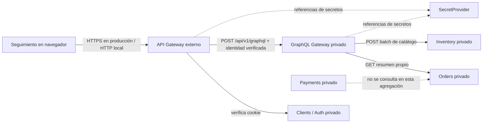

# Módulo 8 — Separación privada y agregaciones GraphQL

**Caso:** Tokyo Noodles.  
**Propósito:** clasificar los servicios detrás del API Gateway y entregar a una pantalla una vista agregada, sin dar acceso público a los subsistemas ni transferir autoridad sobre sus datos.  
**Base:** contratos y pantallas M1; permisos M4; Gateway y políticas M5; rutas y secretos M6; datos y sesiones M7; sistemas y propiedad de datos M3.  
**Estado:** implementación local integrada con Seguimiento y comprobada con el verificador de este módulo. GitHub Pages no ejecuta este backend.

## 1. Decisiones de arquitectura

Se conserva **un API Gateway externo** para todas las solicitudes del navegador y se ejecuta **un GraphQL Gateway dentro de la red privada**. GraphQL cumple un propósito distinto: compone el resumen del pedido desde Orders y las descripciones públicas de Inventory. No se publica `/graphql` como ruta directa ni se agrega una segunda entrada pública.

Se habilita una sola operación de lectura, `myOrderSummary`, para la pantalla Seguimiento (M1 S10). El pedido y su estado oficial siguen bajo autoridad de Orders; Inventory sigue siendo autoridad de catálogo y stock; GraphQL solo prepara una respuesta. El schema no ofrece mutaciones: creación, pago, ajuste de stock y transiciones siguen usando sus contratos de negocio existentes.

`clients` y `payments` son subsistemas transaccionales, pero esta composición no los consulta: la sesión la verifica el Gateway/Clients y la vista no necesita información del intento de pago. No se crean servicios adicionales por cada pantalla, tabla o entidad. Tampoco se implementan analytics ni un servicio de alta demanda: el caso y la carga disponible no justifican duplicar datos o sumar otro límite operativo. Si Analytics se incorpora después, consumiría una proyección autorizada de eventos; no consultaría bases ajenas. Si el catálogo requiriese alta demanda, primero se mediría la carga y se consideraría caché/CDN sobre datos públicos, manteniendo Inventory como autoridad.

## 2. Mapa de clasificación y propiedad

| Servicio | Naturaleza | Responsabilidad y datos bajo autoridad | Contrato utilizado | Dependencias | Motivo del límite / propiedad |
|---|---|---|---|---|---|
| API Gateway | Entrada externa / enrutamiento | Catálogo explícito de rutas y políticas; no es autoridad de pedidos ni clientes. | `POST /api/v1/graphql` y sesiones; allowlist de `gateway-policy.js`. | Clients para verificar sesión; GraphQL privado; SecretProvider local. | Centraliza la frontera externa, sesión, rol, CORS, rate limit y encaminamiento. Evita que el navegador conozca destinos internos. |
| `inventory` | Transaccional | Productos, atributos de catálogo, unidades físicas, reservas, ajustes y disponibilidad derivada. | `POST /internal/catalog/batch` para IDs únicos; otros contratos M3 para catálogo/reservas. | Orders para reserva; Gateway y GraphQL para lectura acotada. | La cohesión está en oferta y stock. No delega escritura del inventario al agregador. El endpoint batch devuelve solo campos de catálogo y no saldo/stock. |
| `orders` | Transaccional | Pedidos, titular, líneas, total calculado, transiciones e historial del pedido. | `GET /internal/orders/{id}/graphql-summary`. | Inventory para precios y reserva; Payments para resultados de pago; GraphQL y Gateway para lectura autenticada. | Pedido y titular cambian juntos según reglas de negocio. Orders filtra por `clientId` y devuelve un DTO mínimo; GraphQL no lee su archivo de datos. |
| `clients` / Auth | Transaccional de identidad | Cuentas demo, rol y validación/firma de sesión. | `POST /internal/sessions/verify` detrás del Gateway. | Gateway. | Mantiene el ciclo de identidad fuera de la consulta GraphQL. GraphQL recibe identidad ya verificada, no contraseñas ni token de usuario en campos. |
| `payments` | Transaccional | Intentos, eventos verificados y resultado oficial de pago; comunica resultado a Orders. | Contratos M3 S08/S09. | Orders y proveedor simulado. | No se consulta en el resumen: Orders conserva el estado oficial del pedido; Payments conserva el estado del pago. La respuesta evita propagar detalles del proveedor. |
| GraphQL Gateway privado | Agregación de lectura | No mantiene datos de negocio. Resuelve campos públicos usando respuestas internas acotadas. | `Query.myOrderSummary(orderId, first, after)`; Orders GET más una llamada Inventory batch. | Orders, Inventory, identidad verificada y referencias secretas distintas por integración. | Facilita una vista de frontend con selección de campos y paginación. La composición pertenece aquí; reglas, titularidad y escritura quedan en cada dueño. |
| Analytics | Analítica | No implementado; no se le asigna autoridad. | Ninguno. | Ninguna. | No existe requisito de métricas de negocio ni volumen de eventos que justifique una copia analítica. |
| Servicio de alta demanda | Especializado / lectura cacheada | No implementado; Inventory sigue autoridad de catálogo y stock. | Ninguno. | Ninguna. | No hay medición de carga que justifique otro servicio. Una caché futura tendría datos públicos y caducidad; jamás sería autoridad para reservar stock. |

**Cohesión, acoplamiento y evolución:** Inventory y Orders evolucionan cada uno alrededor de su dato de autoridad. Orders llama a Inventory usando contratos explícitos para validar precio/reservar; GraphQL llama a ambos mediante contratos HTTP internos y DTOs estrechos. El GraphQL Gateway puede cambiar su presentación sin modificar las reglas de stock/pedido. Los secretos son de consumidor y permiso separados; una falla de GraphQL no habilita la escritura directa en Inventory.

## 3. Mapa de componentes y frontera privada

El diagrama Mermaid editable está en `mapa-componentes.mmd`. Resumen del recorrido:



Los cinco procesos de backend escuchan solo en `127.0.0.1` en la demo: Gateway `4000`, Inventory `4101`, Orders `4102`, Clients `4103`, Payments `4104`, GraphQL `4200`. El navegador recibe la URL pública del Gateway y una cookie HttpOnly. No recibe `X-Service-Token`, tokens técnicos, endpoints de microservicios ni conexión a datos. En despliegue, estos procesos deben vivir en subred privada; el firewall debe permitir al Gateway/GraphQL solo los servicios que consumen.

Las llamadas de GraphQL llevan límites de tiempo de **1,5 s** por Orders e Inventory; el Gateway permite **3,5 s** al agregado. Si Orders no responde, se devuelve error controlado y no se presenta un pedido inventado. Si Inventory no responde, el estado y los importes devueltos por Orders permanecen, `catalogStatus` queda nulo, las fichas de producto se omiten y GraphQL adjunta el error parcial `CATALOG_PARTIAL`.

## 4. Schema, resolver y operación

SDL ejecutable/documental: `MODULO 3/backend/graphql-gateway/schema.graphql`. Tipos y resolvers: `schema.js`; controles y llamadas: `server.js`.

```graphql
type Query {
  myOrderSummary(orderId: ID!): OrderSummary
}

type OrderSummary {
  id: ID!
  status: String!
  fulfillment: String!
  total: Int!
  currency: String!
  timeline: [OrderEvent!]!
  catalogStatus: CatalogStatus
  items(first: Int = 10, after: String): OrderLineConnection!
}

type OrderLine {
  productId: ID!
  quantity: Int!
  unitPrice: Int!
  lineTotal: Int!
  product: CatalogProduct
}
```

La consulta completa y usada por el frontend está en `consulta-prueba.graphql`. Para cada ejecución:

1. API Gateway valida la ruta, sesión de Clients y rol `customer`. Ignora cualquier `X-Verified-*` enviado por el browser y crea esos headers solo desde la sesión verificada.
2. API Gateway encamina una ruta fija a `POST /graphql` privado, con el token exclusivo `GATEWAY_GRAPHQL_TOKEN`.
3. GraphQL solo permite una raíz `myOrderSummary`, una operación `query` y el rol cliente. El resolver llama Orders con `GRAPHQL_ORDERS_READ_TOKEN` e identidad titular verificada.
4. Orders busca el pedido y compara el `clientId` recibido con su dueño guardado. Un pedido inexistente y uno ajeno producen el mismo `ORDER_NOT_FOUND`.
5. GraphQL extrae IDs únicos de las líneas y hace **una sola llamada batch** a Inventory con `GRAPHQL_INVENTORY_READ_TOKEN`. El resolver `OrderLine.product` usa un mapa en memoria; no realiza una llamada por línea (evita N+1).
6. GraphQL combina la línea/estado de Orders con nombre, categoría y descripción pública de Inventory. No lee archivos/DB de otros servicios y no escribe estado.

El cursor de líneas contiene una posición asociada al ID del pedido, es solo un marcador de paginación y no una credencial. Orders valida dueño en cada página, por lo que el cursor no concede acceso. `first` acepta de 1 a 20; valor predeterminado 10. El frontend solicita 5 por página.

## 5. Autorización por recurso y campo

| Actor / identidad | Operación o campo | Decisión | Alcance / condición | Componente que verifica |
|---|---|---|---|---|
| Visitante sin sesión | `POST /api/v1/graphql` | Denegado, 401 | Un header de identidad escrito por el navegador no reemplaza una sesión. | Gateway antes de encaminar. |
| Cliente autenticado | `myOrderSummary` con pedido propio | Permitido | Rol `customer`; la respuesta se limita al pedido titular. | Gateway autoriza rol; Orders compara propietario en cada llamada. |
| Cliente autenticado | `myOrderSummary` con pedido ajeno/inexistente | Denegado como 404 de negocio (`ORDER_NOT_FOUND`) | No revela si el ID existe. | Orders, sistema autoridad. |
| Cliente autenticado | `status`, `fulfillment`, `total`, `currency`, `timeline` | Permitido solo desde el pedido propio | Datos mínimos para entender seguimiento; no incluye actor interno ni notas operativas. | Schema y resolver de pedido; Orders ya aplicó titularidad. |
| Cliente autenticado | `items.product` | Permitido dentro del pedido propio | Solo `id`, `name`, `category`, `description`; no `onHand`, reservas, ajustes ni atributos de inventario. | Schema GraphQL; Inventory proyecta DTO público. |
| Personal `inventory` u `operations` | Esta Query de cliente | Denegado, 403 | Una identidad de personal no adquiere permisos de cliente. | Gateway por policy `role:customer`; GraphQL exige el mismo rol. |
| Identidad de Gateway | `POST /graphql` privado | Permitido técnicamente | Solo con `GATEWAY_GRAPHQL_TOKEN`; debe acompañar identidad verificada producida por Gateway. | GraphQL Gateway valida servicio y rol. |
| Identidad GraphQL | Orders GET | Permitido técnicamente | `GRAPHQL_ORDERS_READ_TOKEN` de solo lectura; Orders además comprueba titular. | Orders. |
| Identidad GraphQL | Inventory batch POST | Permitido técnicamente | `GRAPHQL_INVENTORY_READ_TOKEN`, IDs de 1–30; la ruta solo responde atributos públicos, aunque el verbo sea POST. | Inventory. |
| Payments / Analytics / servicio de alta demanda | Campos de esta Query | No aplicable | No hay vínculo ni motivo para incluir estos datos/servicios. | Sin llamada desde el resolver. |

No existe `Mutation` en el schema. Crear pedido, iniciar pago, ajustar stock o cambiar estado siguen siendo acciones REST separadas con políticas M4/M5. El hecho de que una consulta HTTP use POST no le otorga permiso para cambiar datos.

## 6. Límites, validación y errores

| Control | Decisión ejecutada |
|---|---|
| Body de la petición | 16 KiB máximo. |
| Texto GraphQL | 8 KiB máximo y 1.000 tokens de parser. |
| Schema | Validación GraphQL.js; introspección denegada. No existen campos de dirección, datos tributarios, cliente titular, contraseñas, pagos ni stock interno. |
| Forma de operación | Solo una query raíz `myOrderSummary`; no mutaciones, múltiples raíces ni fragments. |
| Profundidad y costo | Profundidad máxima 6; costo máximo 250, ponderando los campos de líneas por `first`. El schema de solo lectura tiene como máximo estructural seis niveles; no define tipos recursivos que permitan una consulta válida más profunda. |
| Paginación | Tamaño entre 1 y 20; máximo 30 líneas internas por pedido y batch Inventory. |
| Rate limit | Gateway limita ruta a 30 solicitudes por minuto/IP en el demo local. En producción debe ser distribuido y complementarse por identidad. |
| Plazo | 1,5 s por llamado interno; Gateway cancela el agregado a los 3,5 s. |
| Error Orders | No devuelve un agregado parcial que parezca válido; error `ORDERS_UNAVAILABLE` o `ORDER_NOT_FOUND`. |
| Error Inventory | Se mantiene el resumen Orders; `catalogStatus: null`, productos nulos y error parcial `CATALOG_PARTIAL`. |
| Logs | Request ID, estado y duración; sin cookie, token, query GraphQL, ID de cliente ni cuerpo. |
| CORS | Solo orígenes explicitados en `CORS_ALLOWED_ORIGINS`, métodos requeridos y `Content-Type`; solicitudes con cookie. Por defecto se admiten los dos hostnames locales en puerto 5500. |

Se evita que una consulta costosa multiplique llamadas a subsistemas; el agregador no sigue URLs o rutas suministradas por el cliente. Si el ID de producto ya no es publicable o Inventory no responde, la línea histórica y el precio que Orders conserva siguen visibles como dato propio del pedido. La ficha actual queda nula, se devuelve `CATALOG_PARTIAL` y no se presenta una descripción actual que Inventory no entregó.

## 7. Contratos internos y secretos

| Tramo | Contrato | Identidad / secreto | Datos mínimos |
|---|---|---|---|
| Browser → API Gateway | `POST /api/v1/graphql` | Cookie HttpOnly `tn_session`; no secreto técnico en JavaScript. | `operationName`, query permitida, `orderId`, `first`, `after`. |
| API Gateway → GraphQL | `POST /graphql` | `GATEWAY_GRAPHQL_TOKEN`; `X-Verified-Client-Id` y `X-Verified-Role` emitidos por el Gateway después de comprobar sesión. | Cuerpo GraphQL validado por límites del server. |
| GraphQL → Orders | `GET /internal/orders/{id}/graphql-summary` | `GRAPHQL_ORDERS_READ_TOKEN` y `X-Client-Id` confiable derivado de la sesión. | ID, estado, modalidad, total/moneda, hitos y líneas con IDs/cantidades/importes. Sin dueño, dirección, facturación, reserva o datos de pago. |
| GraphQL → Inventory | `POST /internal/catalog/batch` | `GRAPHQL_INVENTORY_READ_TOKEN`; alcance exclusivo de lectura pública. | Lista acotada de IDs; respuesta con ID/nombre/categoría/descripción, sin stock. |

`.env.example` contiene nombres/placeholders, no valores reales. `dev.js` valida que todas las credenciales sean únicas y pasa a cada proceso solo variables permitidas. En producción se requieren TLS, identidad administrada o mTLS, secret manager, mínimos privilegios, rotación y backend no enrutable desde Internet. Nunca se introduce el token de servicio en `seguimiento.js`, HTML, respuestas al browser, capturas ni logs.

## 8. Integración con pantalla y publicación

La pantalla real es `seguimiento.html`, enlazada desde la página Pedido para que sea localizable, con su JavaScript en `js/seguimiento.js`; la copia para Pages está en `docs/`. La página inicia sesión por el Gateway, no guarda contraseña/token en `localStorage` y limpia la contraseña después del login. Luego manda la operación GraphQL por `POST /api/v1/graphql` con la cookie HttpOnly. Actualiza estado, hitos, líneas y botón de siguiente página usando nodos DOM y `textContent`.

El browser no conoce los puertos 4101–4104 ni 4200 y no tiene credenciales técnicas. Los procesos privados se enlazan a loopback; sus rutas rechazan una solicitud directa sin el token específico. El verificador comprueba esa denegación y la autorización de titular.

**Demostración manual:** inicia backend y sirve solo `docs/` con Live Server o con `node M8/servidor-estatico-seguro.mjs`. Autentica con `DEMO_CLIENT_EMAIL`/`DEMO_CLIENT_PASSWORD` y pega el `orderId` que imprimió `node M8/verificar-integracion.mjs`. En DevTools → Network debe aparecer el POST a `:4000/api/v1/graphql` y no a `:4101`, `:4102` ni `:4200`. Un POST sin sesión devuelve 401; una cuenta de personal devuelve 403; un pedido ajeno no entrega datos. La ruta interna GraphQL no tiene publicación pública. La evidencia automatizada se guarda en `Resultados-validacion.md` al ejecutar el verificador. No sirvas la raíz del proyecto: contiene `.env` local.

GitHub Pages sigue siendo solo frontend estático. El endpoint en la meta `tn-gateway-url` se configura por dominio si se usa un servidor remoto. Para el uso local, `seguimiento.js` detecta `localhost` o `127.0.0.1` y llama al puerto 4000 del mismo host. No se declara que Pages ejecute o proteja el backend; su despliegue con cookie segura, HTTPS, CORS y red privada es una tarea de infraestructura posterior.

## 9. Control antes de avanzar

| Pregunta | Resultado |
|---|---|
| ¿Cada servicio tiene función real y un límite según cohesión, acoplamiento, evolución y dato dueño? | Sí para inventory, orders, clients, payments y el agregador. Analytics/alta demanda quedan explícitamente sin crear por falta de necesidad medible. |
| ¿El agregador combina al menos dos subsistemas sin leer bases de datos ajenas? | Sí: Orders + Inventory por contratos privados HTTP; una llamada batch a catálogo, sin acceso a archivos/DB. |
| ¿Identidad verificada, propiedad, campos y rol se controlan en la ruta y en los servicios dueños? | Sí: Gateway y GraphQL exigen customer; Orders vuelve a comparar titular y Inventory proyecta campos públicos. |
| ¿Hay límites de paginación, costo/profundidad, tiempo, errores parciales y batching? | Sí y se ejecutan comprobaciones reproducibles en `verificar-integracion.mjs`. |
| ¿La consulta aparece en una pantalla real y el browser no conoce secretos ni subsistemas? | Sí: `seguimiento.html` y su script llaman únicamente al API Gateway; el verificador rechaza llamadas internas sin credenciales. |

**Pendiente de despliegue:** red multi-host privada, HTTPS, gestor real de secretos, rate limit distribuido, almacenamiento transaccional y configurar el backend para un dominio público. Son tareas de producción; el prototipo local no se presenta como un servicio público desplegado.

## Referencia técnica

Se fija `graphql` **16.14.2** en `package.json`/`package-lock.json` para que la instalación sea reproducible y compatible con Node.js 20; los metadatos oficiales de esa versión declaran soporte de Node.js `>=17`. GraphQL.js aporta parser, validador, ejecutor y tipos de schema usados por este Gateway. [Documentación oficial de GraphQL.js](https://www.graphql-js.org/docs/), [metadatos oficiales de v16.14.2](https://github.com/graphql/graphql-js/blob/v16.14.2/package.json).
